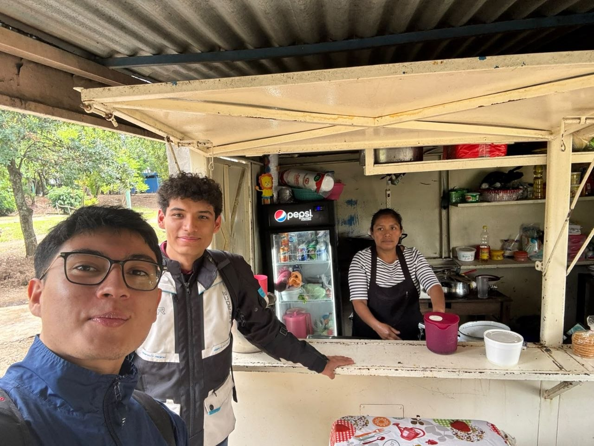
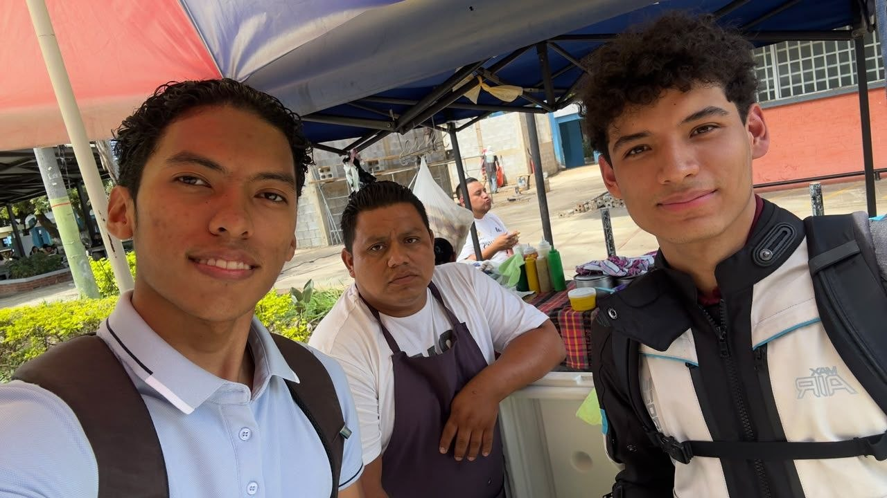

# Evidencias de la Toma de Requerimientos

## Fotografías del Trabajo de Campo

### Negocio 1: Comedor La Bendición

**Descripción:** Fotografía del equipo junto al dueño del Comedor La Bendición durante la realización de la entrevista presencial.

### Negocio 2: Comedor Don Juan

**Descripción:** Fotografía del equipo frente al establecimiento Comedor Don Juan al finalizar la sesión de entrevistas.

## Audios de las Entrevistas

### Entrevista 1: Comedor La Bendición

<audio controls src="/Proyecto2-Comunicacion-Asertiva/audio/entrevista1.mp3"></audio>

**Descripción:** Audio completo de la entrevista realizada a María, con una duración de 7 minutos.

### Entrevista 2: Comedor Don Juan

<audio controls src="/Proyecto2-Comunicacion-Asertiva/audio/entrevista2.mp3"></audio>

**Descripción:** Audio completo de la entrevista realizada a Juan, con una duración de 7 minutos.