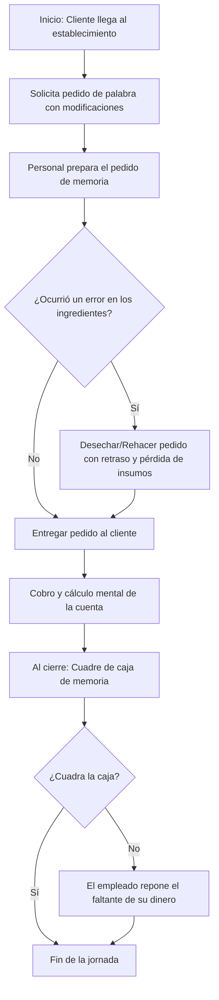

# Diagramas de Flujo del Negocio

## 1. Flujo Actual del Negocio (Sin Automatización)

En la actualidad, ambos comedores operan de forma empírica y sin registros escritos, realizando todos los cálculos y toma de pedidos de memoria, lo que ocasiona congestión y errores frecuentes durante la hora pico del mediodía.

